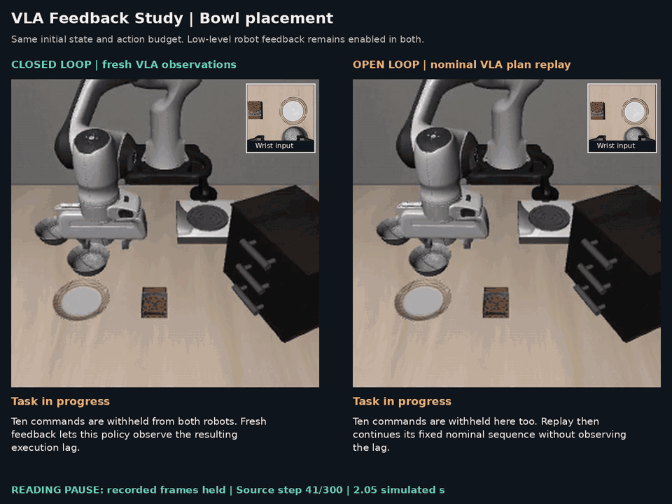
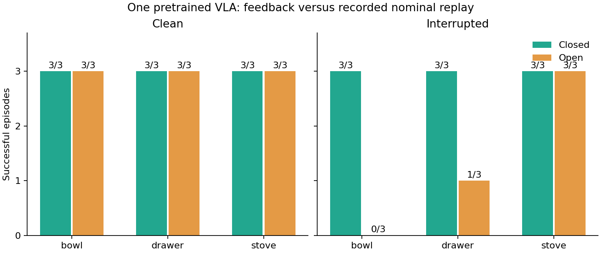

# VLA Feedback Study

**[Watch the explained walkthrough](artifacts/demo/complete-walkthrough.mp4)** · [Bowl placement](artifacts/demo/bowl.mp4) · [Drawer opening](artifacts/demo/drawer.mp4) · [Stove switch](artifacts/demo/stove.mp4)

One **pretrained SmolVLA**, one simulated Panda arm, and three tasks: study how fresh model feedback compares with executing a nominal VLA-generated plan.

The milestone is deliberately limited to **closed-loop versus open-loop execution**. The checkpoint, ten-action execution horizon and robot controller remain fixed. There is no policy training or custom grasp trajectory.

## What “open loop” means here

| Mode | What generates the commands |
| --- | --- |
| Closed loop | Current agent/wrist images, robot state and task instruction go to SmolVLA; execute ten predicted actions, then observe and predict again. |
| Open loop | Replay a full nominal command sequence previously generated by this same VLA on the same task and initial state. New observations are recorded for evidence but never sent to the model. |

This is **high-level feedback versus nominal trajectory replay**. Both retain robosuite's low-level operational-space feedback controller.

SmolVLA predicts 50 actions, not a whole manipulation task. The replay plan is therefore compiled from a separate nominal closed-loop rollout. It is **not a single-shot full-task VLA prediction**, and its model-inference preparation cost is not free.

## What happens in the videos

Both panes begin from the same simulated state. Commands 30–39 are then withheld from both robots: their Cartesian command becomes zero and the previously executed gripper command is retained. Physics and low-level control continue.

After that half-second interruption:

- The closed-loop policy receives the resulting camera/state feedback at its next scheduled query.
- The open-loop execution continues the fixed nominal command sequence.
- LIBERO independently checks the task goal. A valid neural-network output is not task success.

The clips show the predefined initial state 0 for each task, including the original agent view and a wrist-view inset. Source videos are genuine simulated executions. Playback is 0.5× with labeled reading pauses. A pane held after termination is explicitly labeled; it is not additional robot behavior.

## Measured results

**36 primary episode records:** three tasks × three fixed initial states × two execution modes × two conditions. Zero infrastructure failures.

Under clean conditions, both modes succeed in 9/9 cases. Clean replay is expected to match its nominal reference by construction: this is a reproducibility control, not independent evidence that open-loop VLA planning is generally equivalent.

Under the same ten-command interruption:

| Task | Closed-loop success | Open-loop replay success |
| --- | --- | --- |
| Bowl placement | 3/3 | 0/3 |
| Drawer opening | 3/3 | 1/3 |
| Stove switch | 3/3 | 3/3 |
| **Total** | **9/9** | **4/9** |

**Feedback improved completion here, but did not always reduce time to the goal.**

In the four interrupted pairs where both modes succeeded, replay reached the goal sooner:

- Drawer, state 1: replay 133 commands; closed loop 143.
- Stove, states 0/1/2: replay 88/85/77; closed loop 91/91/82.

That timing comparison excludes five replay failures; it must not be presented as an overall timing victory. Replay also makes zero online model calls, while preparing each reference plan required 30 VLA calls.

These are mixed engineering trade-offs, **not a universal ranking**. Three predefined tasks and three fixed initial states do not establish a broad correlation or reliability guarantee. We did not add tasks until a preferred result appeared.

[Full report and paired outcomes](artifacts/report-v2/report.md) · [Machine-readable metrics](artifacts/report-v2/summary.json) · [Frozen protocol](configs/study.json)

## Genuine model integration

The public [lerobot/smolvla_libero](https://huggingface.co/lerobot/smolvla_libero) checkpoint contains approximately 450 million parameters and is pinned at `a24f1f380461b665158d52acd140152c79e8b36d`. Its weights are loaded strictly; no parameters are trained or replaced.

| Interface | Actual representation |
| --- | --- |
| Cameras | Agent and wrist RGB, each 256×256; orientation handled as in LeRobot's LIBERO processor |
| State | End-effector world position (3), axis-angle orientation (3), two gripper joint positions (2) |
| Language | The supported LIBERO task instruction |
| Prediction | 50×7 normalized actions |
| Executed action | Checkpoint-denormalized relative translation (3), relative axis-angle rotation (3), gripper (1) |
| Feedback interval | Ten commands; fixed throughout this study |
| Control / physics | 20 Hz commands; existing 2 ms simulation/controller integration |

The checkpoint's existing processors rename cameras, tokenize language and normalize state/actions. The policy internally resizes/pads images to 512×512 and maps pixels to its expected range. We do not substitute Euler angles for axis-angle state or interpret action values as joint positions.

Robosuite's OSC controller scales translation/rotation commands and applies the robot dynamics. Gripper −1 opens and +1 closes. Raw predictions, denormalized values, bounded commands and observed execution are saved separately. Focused physical tests verify translation response and gripper sign.

## Architecture

~~~mermaid
flowchart LR
    A[LIBERO cameras and 8D state] --> B[Lossless localhost transport]
    B --> C[LeRobot checkpoint processors]
    C --> D[Pretrained SmolVLA on local GPU]
    D --> E[Ten-action execution buffer]
    E --> F[Existing Panda OSC controller]
    F --> G[MuJoCo physics and task predicate]
    G --> A
    H[Recorded nominal VLA plan] --> F
~~~

Two local Python environments separate the modern policy dependencies from the older LIBERO/robosuite stack. There is no cloud inference service. The small HTTP process is bound to localhost.

**Simulation pauses during synchronous inference.** The measured policy-pipeline latency in the primary batch is about 0.29 s median and 0.34 s p95. Peak PyTorch GPU allocation was about 1.39 GiB on an RTX 3060 Laptop GPU; driver/context memory is additional. A 20 Hz simulation control rate is not a claim of real-time physical deployment.

Existing software provides the model, preprocessing, physics, cameras, controller, initial states and success predicates. Project code supplies execution-mode selection, the paired protocol, input/action evidence, reporting and explained clips.

## Setup and run

The inspected machine is configured and tested. From this folder, with the model service stopped:

~~~bash
bash scripts/run.sh artifacts/my-new-study
~~~

This starts an owned local policy process, executes the 36-record study in a new directory, generates its report and cleans up that policy process. It refuses an existing output or an already occupied model port.

For setup on another Linux machine, install Git, uv, FFmpeg and an appropriate NVIDIA driver, then:

~~~bash
git clone https://github.com/hiteshhedwig/vla-feedback-study.git
cd vla-feedback-study
bash scripts/setup.sh
~~~

Setup creates separate Python 3.12 policy and Python 3.10 simulator environments, obtains pinned source/model assets and downloads no training dataset. Allow several GB for CUDA dependencies and assets.

On this machine the policy environment reuses the existing GPU Torch/core installation without modifying it; the project-local simulator environment was installed independently. The full fresh GPU dependency-install branch is provided as a recipe, rather than claimed as a separately executed clean-machine installation. [Setup details and versions](docs/setup.md).

To render a new study after it finishes:

~~~bash
.venv-sim/bin/python scripts/render_demo.py --runs artifacts/my-new-study --output artifacts/my-new-demo
~~~

The supplied walkthrough and animation have already been fully decoded and visually checked.

## Evidence and verification

**19 tests pass**, including the original Milestone 1 audits and the new horizon-provenance check. They audit actual recorded inference/execution, not mocked model success:

- Camera/state dimensions and semantic conversions.
- All predicted actions, checkpoint denormalization and execution provenance.
- Identical initial conditions and clean replay physics.
- Matching inputs, model noise and actions before the intervention.
- Exact intervention timing and independent task outcomes.
- Real controller translation/gripper behavior and invalid-command rejection.
- Reexecution of every saved model input on the dependency-aligned runtime.

Each trial contains `scenario.json`, `manifest.json`, raw video, lossless observations, prediction chunks, executed commands, physics state and task result.

The final study is `artifacts/study-v2`. An earlier development batch is retained separately after its reproducibility audit found a pre-intervention divergence. It is excluded from the primary results. Further diagnostics localized a later repeat's drift to two RGB channel values changing by 1/255, with identical robot state and model noise. The task still completed at the same step. We do not promise pixel-perfect simulation repeats.

All **370 primary-study model inputs** were reexecuted after aligning dependency bounds, reproducing their predictions exactly. Collection/runtime versions remain separately recorded. [Reproducibility and diagnostics](docs/reproducibility.md).

[Current test output](artifacts/milestone2/tests.log) · [Runtime revalidation](artifacts/runtime-revalidation.json) · [Verification summary](artifacts/verification-summary.json)

## Milestone 2 — one-scene chunk execution check

**[Watch the three-mode comparison](artifacts/milestone2/comparison.mp4)** · [Measured report](artifacts/milestone2/report.md)

The same bowl-placement scene was executed once with **1, 10 or 50 actions used
per inference**, with a 150-action budget. All three succeeded:

| Actions used per inference | Executed actions | Model calls | Total inference time |
| --- | --- | --- | --- |
| 1 | 78 | 78 | 24.03 s |
| 10 | 79 | 8 | 2.96 s |
| 50 | 78 | 2 | 0.58 s |

Buffering more predictions amortized model-inference cost in this scene; it reduced the number of calls, not the latency of a single call. Every call
still predicts 50 actions: the one-action mode discards the rest and replans; it is
**not a natively sequential model**. No artificial delay was added. Physics pauses
during inference, so this does not demonstrate real-time deadline handling or action
starvation. Run order was 10, 1, 50; cold-start overhead remains in the measurements.

This is three smoke-test episodes, separate from Milestone 1's 36-record study.
A broader horizon/reliability study remains future work.

~~~bash
# Start scripts/policy_server.py in another terminal, then:
.venv-policy/bin/python scripts/run_chunk_smoke.py --output artifacts/my-chunk-smoke
~~~

## Scope

Milestone 1 contains the multi-task feedback study. Milestone 2 currently adds only the one-scene execution-horizon smoke check above. Recovery-policy comparisons, broader horizon evaluation and asynchronous inference remain future work. There is no claim of physical-hardware validation, a new controller, a general evaluation platform or a new VLA.

[Protocol and interfaces](docs/protocol.md) · [Reproducibility](docs/reproducibility.md) · [Attribution](THIRD_PARTY_NOTICES.md)
